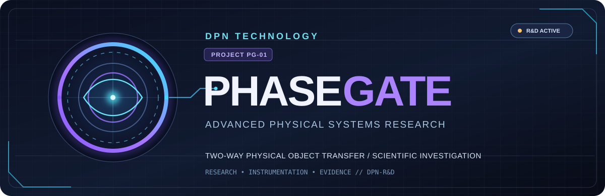
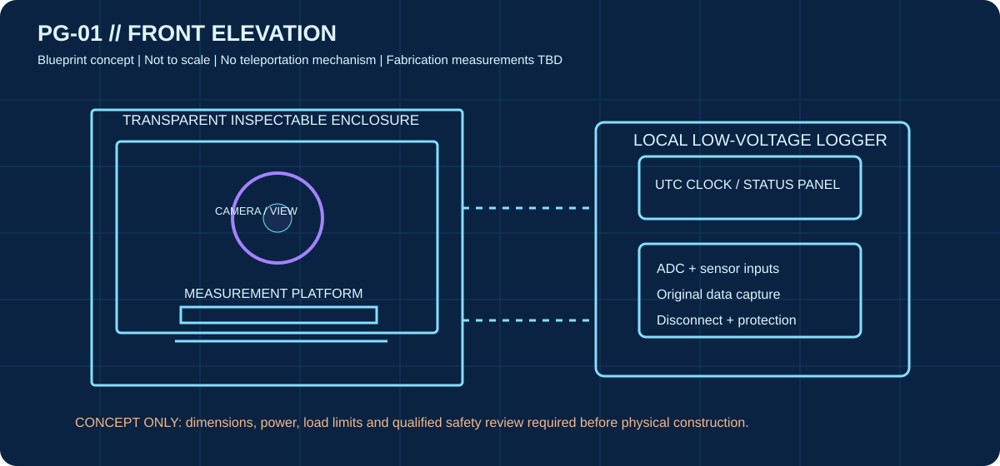
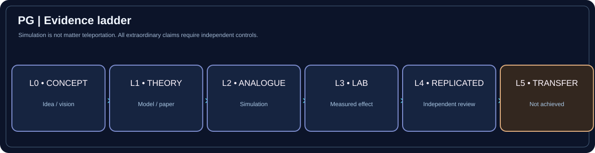
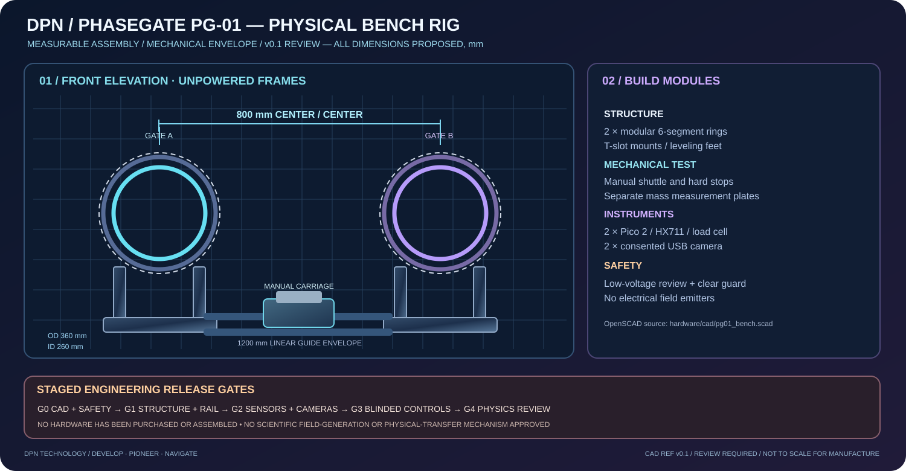
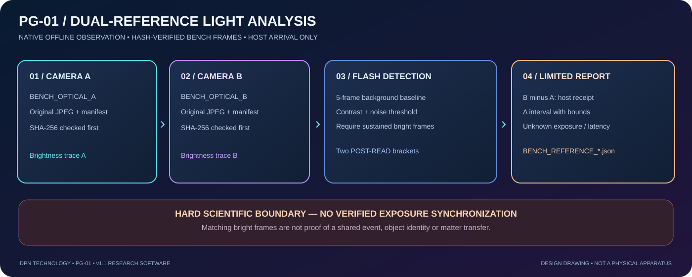
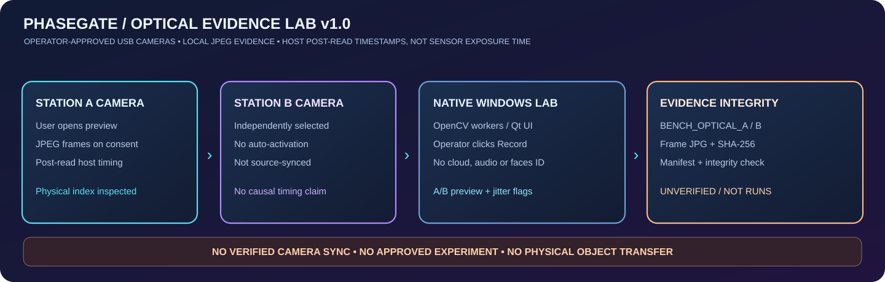
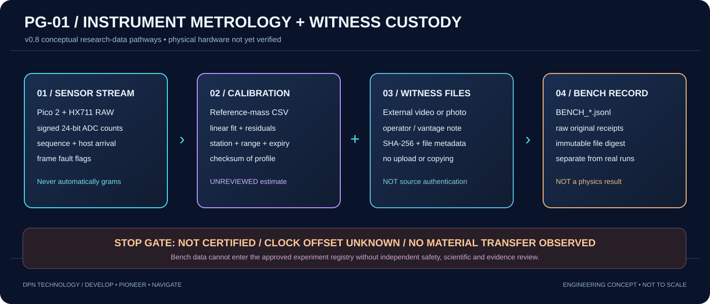
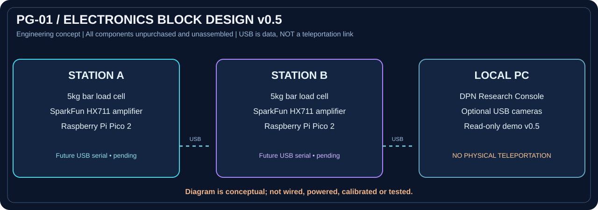
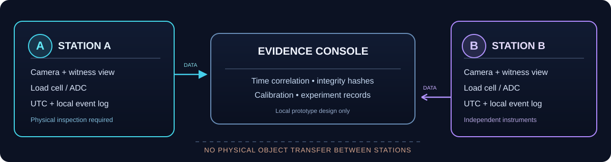

<div align="center">



<br>

**A DPN Technology research program exploring the scientific feasibility of two-way physical-object transfer.**

[](https://github.com/DevelopPioneerNavigate/DPN-PhaseGate/actions/workflows/research-integrity.yml)


**[VISUAL ATLAS](docs/VISUAL-ATLAS.md)** · **[PROJECT OVERVIEW](docs/PROJECT-OVERVIEW.md)** · **[START HERE](docs/START-HERE.md)** · **[ENGINEERING](docs/engineering/PG-01-architecture.md)** · **[RESEARCH DATA](data/README.md)** · **[ISSUES](https://github.com/DevelopPioneerNavigate/DPN-PhaseGate/issues)**

</div>

---

### Mission at a glance

**Ultimate scientific question:** Could the *same intact physical object* enter one gateway and emerge from a separate gateway, in either direction, without traveling by conventional means?

**Our work today:** Build an accountable research library and design safe **measurement stations** that could examine claims under controlled conditions. **We have not demonstrated a physical portal, traversable wormhole, or object teleportation.**


> [!IMPORTANT]
> **Evidence boundary:** Quantum teleportation transfers quantum information, not intact macroscopic objects. Our planned PG-01 equipment measures and documents experiments; it does not physically transport matter. A green software check validates data structure, **not** a breakthrough in physics.

### Illustrated research atlas

The complete research library now has visual guides, labelled concept blueprints, an evidence ladder and direct links to manufacturer hardware photographs. **Start with the diagrams, then use the detailed scientific notes.**

| Explore our engineering drawings | Understand evidence and scientific limits |
|:--|:--|
|  |  |
| **[View the complete blueprint set →](docs/engineering/PG-01-BLUEPRINTS.md)** | **[Explore the physics guide →](docs/physics/PHYSICS-COMMAND.md)** |


**[Open the complete PhaseGate Visual Research Atlas →](docs/VISUAL-ATLAS.md)**

### PG-01 v1.4 — Dimensional Inspection & Fabrication Readiness

The native **Gate Engineering Lab** now includes a fourth tab, **FIT & RECEIVING**, with five candidate dimension checks, operator attribution, evidence notes, part receiving states and local tamper-evident audit entries. No purchases or fabrication are marked completed; the dimensions and tolerances are preliminary review thresholds, not a manufacturing approval.

[Fabrication readiness code](desktop/fabrication.py) · [Test suite](tests/test_fabrication.py) · [Build CAD workflow](https://github.com/DevelopPioneerNavigate/DPN-PhaseGate/actions/workflows/pg01-cad.yml)

### PhaseGate v1.3 — From Industrial Concept to a Physical Engineering Build



**We are developing a physical test rig, not only rendering a machine.** The first build is a low-voltage, two-station metrology chassis: six-piece modular rings, mechanically supported Gate A/B frames, a manually moved central payload tray, separate raw mass sensors, consented optical witnesses and a traceable engineering assembly log.

| Machine design | Real parts & CAD | Windows construction application |
|---|---|---|
| [PG-01 Physical Hardware Plan](hardware/README.md) | [Parametric OpenSCAD CAD](hardware/cad/pg01_bench.scad) · [Versioned Engineering BOM](data/engineering/pg01-rig-manifest.json) | [Gate Engineering Lab](desktop/build_page.py) |
| [Detailed Assembly Milestones](hardware/assembly/PG01-ASSEMBLY-PLAN.md) | [CAD → STL Downloads](https://github.com/DevelopPioneerNavigate/DPN-PhaseGate/actions/workflows/pg01-cad.yml) | [Latest Windows v1.3 EXE](https://github.com/DevelopPioneerNavigate/DPN-PhaseGate/actions/workflows/native-windows-exe.yml) |

**Natively implemented:** Gate Engineering workspace with dimensioned machine schematic, material list, assembly task dependencies, manual progress/evidence recording, acceptance gates and CSV export. GitHub Actions uses **free OpenSCAD** to build provisional ring-segment, camera-bracket and payload-tray STL files for 3D-print fit checks; it also exports a BOM/assembly pack.

**What is still physical work:** purchasing parts, qualified power design, manufacturing, assembly, optical alignment, calibration and independent controls. Dimensions are proposed engineering envelopes, not fabrication approvals. The dramatic energized aperture in our visual target is a proposed research objective—**no working field-generation or object-transport mechanism is established or claimed**.

### NEXUS v1.2 — A Full Native Windows UI Reconstruction

**The previous dashboard architecture has been replaced.** PhaseGate's new NEXUS interface uses a compact mission dock, a much larger bespoke 3D-style *conceptual* reactor illustration, an interactive station operations console, an integrated scientific registry dashboard, distinctive DPN Obsidian styling and a permanent research-safety footer.

| Windows v1.2 EXE | Actual redesigned native screenshots | Full rebuild details |
|---|---|---|
| **[Download the latest successful PhaseGate v1.2 build](https://github.com/DevelopPioneerNavigate/DPN-PhaseGate/actions/workflows/native-windows-exe.yml)** | [Six original Qt screenshot artifacts from the same build](https://github.com/DevelopPioneerNavigate/DPN-PhaseGate/actions/workflows/native-windows-exe.yml) | [NEXUS native interface design](docs/design/NEXUS-v1.2.md) |

**Working commands:** `Ctrl+K` navigation search, `Ctrl+B` show/hide the navigation dock, `F11` full-screen mode. The home screen opens actual Hardware, Optical and Reference Event workspaces. The visualization remains original **synthetic concept art**; it does not prove a physical matter-transfer mechanism.

### PG-01 v1.1 — Reference Event & Timing Analysis



**New eleventh native screen:** reference-light brightness detection on **existing** consented A/B BENCH camera captures, audit of original frame hashes, original-frame-index charts, host-after-read interval brackets **only after an explicit same-host/no-reboot declaration and overlapping capture check**, and separate BENCH-only analysis exports. The app still **does not** infer a synchronized camera exposure, authenticate the original scene or demonstrate physical-object transfer.

| Windows standalone v1.1 | Guided evidence procedure | Reference analysis source |
|---|---|---|
| [Latest successful v1.1 EXE / native preview artifacts](https://github.com/DevelopPioneerNavigate/DPN-PhaseGate/actions/workflows/native-windows-exe.yml) | [PG-01 Reference Event v1.1](docs/engineering/PG01-REFERENCE-EVENT-v1.1.md) | [Detection model and integrity rules](desktop/reference_event.py) |

The 11-page AURORA command palette (Ctrl+K) now includes **Reference Events**. No actual reference flash test has been performed by this software release. **Source data tests are synthetic, not experimental evidence.**

### PG-01 v1.0 — Optical Evidence & Timebase Lab



**New tenth native workstation:** Select and explicitly authorize independent USB camera previews for Stations A/B, start and stop local JPEG still-frame recordings only with separate permission, and verify frame-by-frame SHA-256 evidence plus independent host-arrival jitter. No automatic webcam access, uploading, audio, or scientific promotion of bench records.

| Download standalone native EXE | Guided camera setup | Auditable evidence source |
|---|---|---|
| **[PhaseGate v1.0 Windows builds](https://github.com/DevelopPioneerNavigate/DPN-PhaseGate/actions/workflows/native-windows-exe.yml)** | [Optical Evidence Lab v1.0](docs/engineering/PG01-OPTICAL-EVIDENCE-v1.0.md) | [Source code / optical integrity checker](desktop/optical.py) |

**Known limits:** Host camera timestamps occur **after** camera `read()`, not at exposure. Driver buffering, camera clock offsets and actual simultaneity remain **unknown**. JPEG recordings are `BENCH_OPTICAL_*` files, **not verified teleportation evidence**. Camera and wiring have not been physically validated by software tests.

### AURORA v0.9 — A Completely Reimagined Native Windows Experience

**A genuine native Qt application, completely redesigned** around DPN's research identity: a luminous 3D-style orbital *concept artwork*, modern mission control, scientific readiness rail, expressive cyan/violet engineering panels, fast page search, immersive fullscreen mode, and stronger styling across the Hardware and Evidence Labs.

| Get v0.9 standalone Windows EXE | Inspect actual native UI screenshots | Design + operating guide |
|---|---|---|
| **[Download latest successful AURORA v0.9 EXE build](https://github.com/DevelopPioneerNavigate/DPN-PhaseGate/actions/workflows/native-windows-exe.yml)** | **[Screenshots appear as v0.9 Preview artifact in the same successful run](https://github.com/DevelopPioneerNavigate/DPN-PhaseGate/actions/workflows/native-windows-exe.yml)** | [AURORA v0.9 design architecture](docs/design/AURORA-v0.9.md) |

**Functional UX:** `Ctrl+K` opens destination search, `Ctrl+1–9` changes pages, `F11` toggles fullscreen, and on-screen launch actions open real internal workspaces. No web server or browser is used. The program's underlying USB RAW acquisition, unreviewed calibration estimation, local bench captures and witness-custody functions remain intact.

**Science disclosure:** Cinematic energy fields and diagnostic waveforms are explicitly *synthetic artwork*; no physical portal, actual object transfer, synchronized sensor clocks or measured optical evidence has been demonstrated.

### PG-01 v0.8 — Calibration & Witness Evidence Lab



**New native ninth screen:** create versioned per-station reference-mass calibration profiles, load them for range-limited **UNREVIEWED BENCH ESTIMATE** displays in Hardware Lab, review USB arrival-cadence problems and inventory independently recorded witness footage by SHA-256 *without importing the video*. Full Qt/Windows smoke coverage and tests.

| Get the Windows EXE | Read the visual guide | Test safely |
|---|---|---|
| [Latest successful PhaseGate v0.8 EXE build](https://github.com/DevelopPioneerNavigate/DPN-PhaseGate/actions/workflows/native-windows-exe.yml) | [PG-01 Calibration & Witness v0.8](docs/engineering/PG01-CALIBRATION-AND-WITNESS-v0.8.md) | [Synthetic-only reference CSV fixture](examples/SYNTHETIC-pg01-v0.8-reference-worksheet.csv) |

**No physical device, actual reference-mass calibration, clock synchronization or matter teleportation was verified during software development.** Existing command-center graphics remain synthetic and never become real experiment records.

### PG-01 v0.7 — USB Hardware Lab / Real Raw Acquisition

**Now developed:** The native Windows EXE includes an eighth screen, **Hardware Lab**, where an operator can explicitly select two independent USB serial ports and view actual **RAW HX711 ADC counts** transmitted from properly inspected Raspberry Pi Pico 2 stations. This is a measurement/monitoring capability — not teleportation.

| Native EXE | Firmware + wiring | Raw data audit |
|---|---|---|
| **[Download latest successful v0.7 Windows artifact](https://github.com/DevelopPioneerNavigate/DPN-PhaseGate/actions/workflows/native-windows-exe.yml)** | [Pico 2 / HX711 MicroPython guide](firmware/pico2_hx711/README.md) | [Bench-capture verification](tools/verify_bench_capture.py) |
| [Full Hardware Lab manual](desktop/README.md) | [PG-01 vetted design constraints](docs/engineering/PG01-PROTOTYPE-SPECS-v0.5.md) | BENCH_*.jsonl + SHA-256 only, not experimental results |

**Scientific and device status:** Software integration is implemented and tested using simulated USB frames. **No physical sensor hardware has been connected or validated by this project yet.** The Command Center charts and portal rings remain explicitly SYNTHETIC. Actual USB data appear only in Hardware Lab, as uncalibrated sensor counts. USB frame checksums are not cryptographic evidence and do not imply physical matter transport.

### Native Windows App — PhaseGate Research Operations v0.6 (desktop foundation)

**Major upgrade:** the primary PhaseGate software is now a **true PySide6/Qt native Windows desktop application**, replacing the basic browser console as our development focus. Animated orbital graphics, seven functional screens, diagnostics, source explorer, custom icon, real window controls, research inventory and offline operation. **All station telemetry remains clearly marked as SYNTHETIC**; no portal or connected instruments exist.

| Download | Preview | Engineering |
|---|---|---|
| **[Native Windows EXE builds](https://github.com/DevelopPioneerNavigate/DPN-PhaseGate/actions/workflows/native-windows-exe.yml)** — open a successful run, download the v0.6 artifact, extract and launch DPN-PhaseGate.exe | **[Native UI screenshot artifact](https://github.com/DevelopPioneerNavigate/DPN-PhaseGate/actions/workflows/native-windows-exe.yml)** — included in successful Windows builds | [Native desktop manual](desktop/README.md) · [Hardware blueprint](docs/engineering/PG01-PROTOTYPE-SPECS-v0.5.md) |

The application is a compiled **standalone .exe**, not a browser wrapper. Existing v0.5 browser code remains under [legacy console/](console/README.md) for historical reference.

For development with Python 3.12+ on Windows:

```powershell
python -m pip install -r desktop/requirements.txt
python -m desktop
```

CI smoke-tests Qt screens and uploads the screenshot plus actual Windows executable after packaging.

### PG-01 Research Console v0.5 — Legacy Browser Prototype

**Now implemented:** a responsive, locally running DPN-themed demonstration console. It shows two **simulated** measurement stations, a moving synthetic chart, project record counts, demo audit events and a clearly marked synthetic-only export. No hardware, cameras, transfer events or actual experiment logging are connected.



| Run on Windows | Engineering specifications | Electrical signal drawing |
|---|---|---|
| **[Double-click START_PHASEGATE_CONSOLE.bat](START_PHASEGATE_CONSOLE.bat)** (after cloning) | [PG-01 prototype parts and sizing](docs/engineering/PG01-PROTOTYPE-SPECS-v0.5.md) | [Proposed HX711 / Pico 2 signal map](assets/pg01-interface-pinout-v0.5.svg) |

For a terminal launch (Python 3.12+, no extra packages):

    python -m console.server --port 8765

Then open **http://127.0.0.1:8765**. This is a local, read-only synthetic demonstration; don't expose it to the internet. **[Full console instructions →](console/README.md)**

### Pick your path

| **01 / EXPLORE** | **02 / ENGINEER** | **03 / VERIFY** |
|:--|:--|:--|
| Understand the science, the limits of existing experiments, and the open questions. | See how the two PG-01 stations would be instrumented and built safely. | Understand how we document sources, calibration, controls and real experimental evidence. |
| **[Explore the science →](docs/physics/baseline.md)** | **[Open hardware design →](docs/engineering/PG-01-architecture.md)** | **[Open the evidence model →](data/README.md)** |
| [Research questions](docs/physics/questions.md) · [2025 scientific debate](docs/physics/2025-wormhole-scrutiny.md) | [Bill of materials](docs/engineering/PG-01-bom.csv) · [PG-01 implementation plan](docs/engineering/PG01-IMPLEMENTATION-PLAN.md) | [Safety standards](docs/safety/safety.md) · [Proposed null test](docs/protocols/PG-PROT-NULL-001.md) |

### System blueprint · PG-01



**Station A and Station B** are planned as independently observable, low-voltage measurement systems. Their data would be collected by a research console for timing, calibration and evidence integrity.

**[Full technical architecture →](docs/engineering/PG-01-architecture.md)** · **[Requirements →](docs/engineering/requirements.md)**

### The development path


| Stage | Current position | Next meaningful gate |
|:--|:--|:--|
| **R0 — Research foundation** | Established · literature records, issues and data checks | Keep sources and evidence limitations current |
| **R1/R2 — Scientific review & PG-01 design** | In progress · candidate architecture, no purchased parts | Approve measurement requirements and qualified safety review |
| **R3 — Bench validation** | Not started · no experiments recorded | Calibrate, preregister and document safe null trials |
| **R4+ — New-physics investigation** | Research goal only · mechanism unknown | Quantitative, falsifiable theory and independent expert review |

[Complete roadmap and release gates →](docs/roadmap.md)

### Research inventory

| Registered source records | Registered hypotheses | Conducted experiment records |
|:--:|:--:|:--:|
| **13** | **2** | **0** |
| [Literature register](data/literature/sources.json) | [Hypothesis register](data/hypotheses/hypotheses.json) | [Actual-run manifest](data/experiments/manifest.json) |

<sub>Inventory snapshot: 2026-10-22. Counts represent repository records, not proof of physical transfer. Synthetic examples are excluded from actual experimental results.</sub>

### Run the offline integrity checks

Python 3.12 or later; no extra packages or paid AI API tokens are required for these local commands.

```bash
python tools/validate_research.py
python -m unittest discover -s tests -v
python tools/validate_readme.py
python tools/pg01_calibration.py calibrate examples/SYNTHETIC-pg01-calibration.csv
```

The calibration sample is **synthetic** and does not represent a real experiment.

### Project directory

| Area | Purpose |
|:--|:--|
| [docs/PROJECT-OVERVIEW.md](docs/PROJECT-OVERVIEW.md) | Plain-English research mission, boundaries and next decisions |
| [docs/physics/](docs/physics/baseline.md) | Evidence levels, core papers, theory, conflicting interpretations |
| [docs/engineering/](docs/engineering/PG-01-architecture.md) | PG-01 measurement architecture and component planning |
| [docs/protocols/](docs/protocols/PG-PROT-NULL-001.md) | Draft test protocols, preregistration and controls |
| [data/](data/README.md) | Literature, hypotheses and genuine run manifests |
| [tools/](tools/validate_research.py) | Data-validation, calibration and integrity utilities |
| [.github/](.github/workflows/research-integrity.yml) | Workflow green gates and structured project issue forms |

**Research contribution:** Start with [START HERE](docs/START-HERE.md), open a [research question](https://github.com/DevelopPioneerNavigate/DPN-PhaseGate/issues/new/choose) and use [contribution standards](CONTRIBUTING.md). No unsafe experiments or unsupported teleportation claims.

---

<div align="center">


<sub>© 2026 DPN Technology · All rights reserved · Research program, not an operating teleportation device.</sub>

</div>
