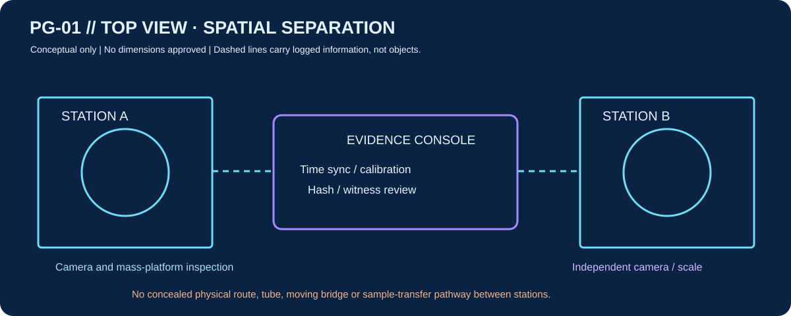
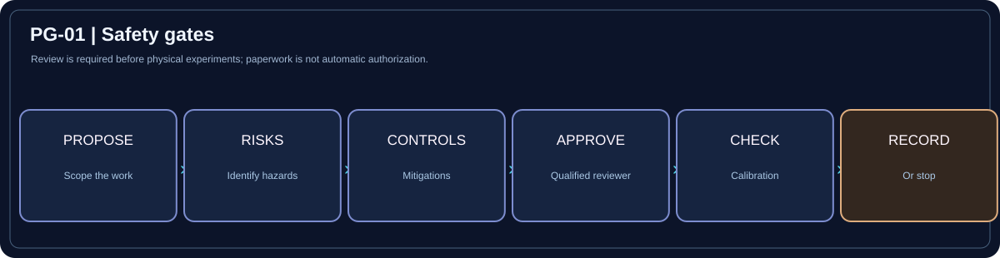

# DPN PHASEGATE | VISUAL RESEARCH ATLAS

[← Main PhaseGate command center](../README.md) · [Start here](START-HERE.md) · [Project overview](PROJECT-OVERVIEW.md)

**Purpose:** one visual map of the scientific research, PG-01 engineering, safety and experimental data. Use the diagrams to orient yourself, then open the linked detailed document to review the assumptions and evidence.

> **Scientific status:** Physical two-way transport of intact objects is **not demonstrated**. PG-01 is a conceptual *measurement* station design, not a working portal.

## NEW / Calibration and independent witness evidence

**[Explore the guided Calibration & Witness Evidence Lab →](engineering/PG01-CALIBRATION-AND-WITNESS-v0.8.md)**. Estimates remain unreviewed and the independent witness data stay out of the real experiment manifest.

## 01 — The engineering station concept

[**Open the full four-view blueprint gallery →**](engineering/PG-01-BLUEPRINTS.md)

| See | Open | What you will find |
|---|---|---|
| Front and top station views | [Blueprints](engineering/PG-01-BLUEPRINTS.md) | Illustrated component locations, separation and important TBDs |
| Device-to-device architecture | [Architecture](engineering/PG-01-architecture.md) | Instrument/control interfaces and engineering limits |
| Component candidates and real product images | [Hardware reference](engineering/PG-01-BLUEPRINTS.md#05--real-component-reference-photography-and-manufacturer-drawings) | Official manufacturer photographs, drawings and datasheets |
| Build-stage checklist | [Implementation plan](engineering/PG01-IMPLEMENTATION-PLAN.md) | Requirements, risk controls and no-go decisions |

## 02 — Understand the science, without confusing models for physical reality

[**Open the physics guide →**](physics/PHYSICS-COMMAND.md)

**Reading order:** [Scientific baseline](physics/baseline.md) → [Feasibility barriers](physics/feasibility.md) → [2025 paper/correction/critique](physics/2025-wormhole-scrutiny.md) → [Open questions](physics/questions.md).

## 03 — See how a real research claim is recorded

[**Open the evidence workflow →**](physics/EVIDENCE-WORKFLOW.md)

[**Open raw data rules →**](../data/README.md) · [Real-run manifest](../data/experiments/manifest.json).

## 04 — Safety is a prerequisite

[**Open safety command →**](safety/SAFETY-COMMAND.md) · [Risk register](safety/risks.md).

## 05 — One screen: where we are

| Workstream | Status | Next step |
|---|---|---|
| Scientific research | Active | Review source limitations and competing explanations |
| PG-01 measurement hardware | Paper design | Decide sizes, selected components and safe supply |
| Instrumentation calibration | Not performed | Qualified design approval, then actual reference measurements |
| Real PhaseGate experiments | **0** | None authorized or performed |
| Verified matter teleportation | **0** | No supported mechanism or demonstration |

**Artwork is original, conceptual DPN Technology SVG.** Dimensions are deliberately unspecified. It is **not a manufacturer drawing** or a claim of a finished apparatus. Scientific papers and hardware photography are linked to their original providers rather than reproduced without permission.
