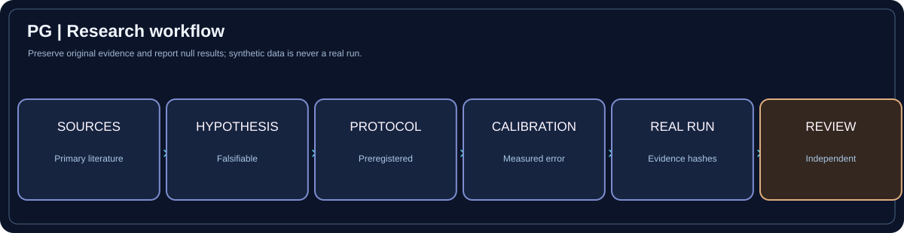
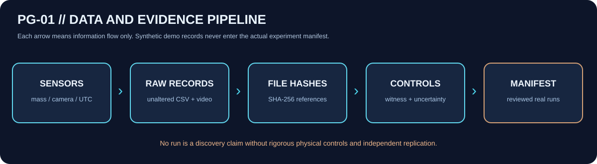

# DPN PhaseGate // Evidence workflow

**[← Visual Atlas](../VISUAL-ATLAS.md)** · [Physics Command](PHYSICS-COMMAND.md) · [Research Data](../../data/README.md)

## Six stages with measurable completion rules

| Stage | What is recorded | Pass criterion | Failure state |
|---|---|---|---|
| 01 Sources | Primary citations, DOI, source type, **non-claims** | Identifiable credible original | Unsupported assertion |
| 02 Hypothesis | ID, quantitative prediction, null model, falsifier | Mechanism can in principle be contradicted | Unfalsifiable |
| 03 Protocol | Preregistered run methods, shams, risk assessment | Methods reviewed before data collection | Post-hoc testing |
| 04 Calibration | Reference values, uncertainties and clocks | Error budget characterized and reviewed | Timing/sensor ambiguity |
| 05 Real run | Operator, witness, controls, raw evidence hashes | Original and manifest traceable | Synthetic/unregistered data |
| 06 Review | Alternatives, replication and limitations | Independent skeptical evaluation | Inflated discovery claim |

## Data-flow image

**Example chain:** a real instrument records mass readings and video → original files preserved → SHA-256 hashes logged → blinded control comparison → run manifest updated only after actual approved experimental work. A synthetic demo must remain outside this chain.

**Where records live:** [Literature](../../data/literature/sources.json) · [Hypotheses](../../data/hypotheses/hypotheses.json) · [Actual experiments](../../data/experiments/manifest.json) · [Protocols](../protocols/PG-PROT-NULL-001.md).

> Software validation only catches structural errors. It cannot prove the authenticity of field observations, approve safety or demonstrate new physics.
